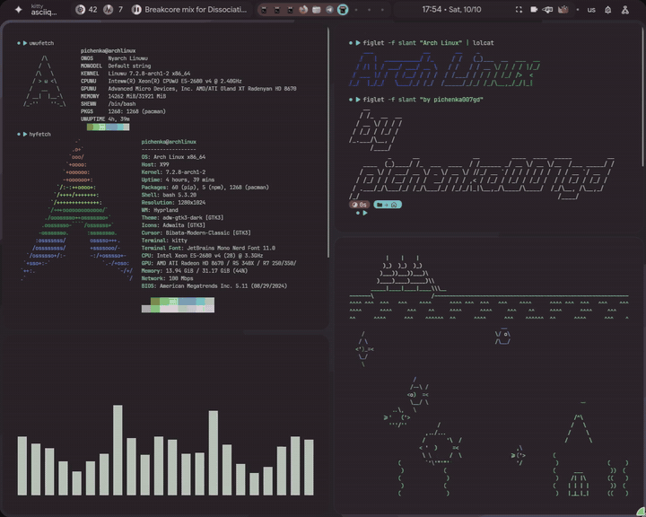
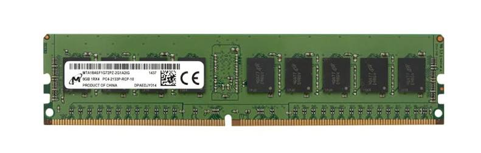
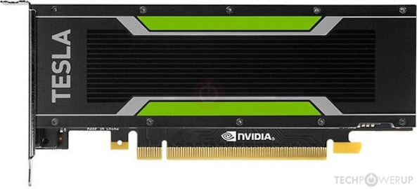
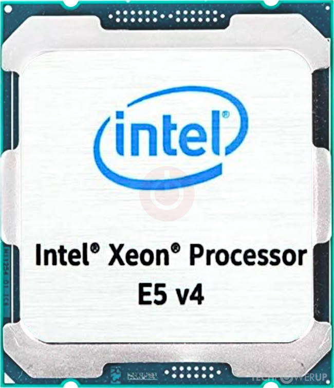
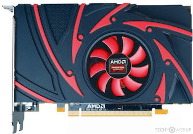
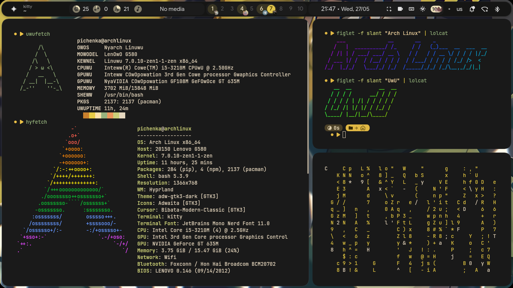
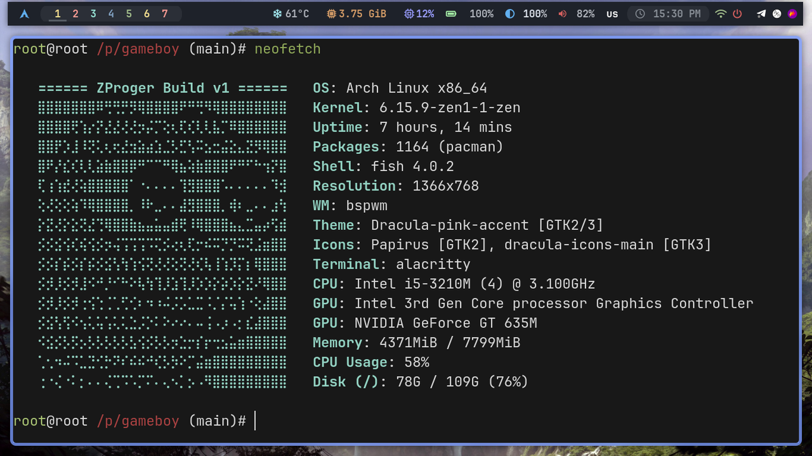

  
  
  
  
  

<h1>Yo Bro 💖</h1>

<table>
  <tr>
    <td width="60%">
      
I'm a coder from the oven 🧁🔥, baking Python scripts and low-level magic while arguing with my Arch terminal (yes, it’s best OS btw ). I write code for hours - sometimes accidentally summoning waiter-fueled coding marathons. Vectors? Low-Level? UwU

      
I know the math for LLMs — tensors, gradients, losses, optimization — all the spicy internals. I dive deep into higher math too: series, limits, derivatives, all that calculus sorcery. I just don't train models yet (the GPU oven arrived: Tesla P4 8GB 🔥) (so i target it).

    </td>
    <td width="40%" align="center">
       
    </td>
  </tr>
</table>

## Tech Stack

  
  
  
  
  
  
  
  
  

## My Server

<table>
  <tr>
    <td width="65%"></td>
    <td width="35%" align="center">
       
       
       
       
       
       
      
    </td>
  </tr>
</table>

### Hardware

<table>
  <tr>
    <td align="center"></td>
    <td align="center"></td>
    <td align="center"></td>
  </tr>
</table>

## Now

  

## Old

  

